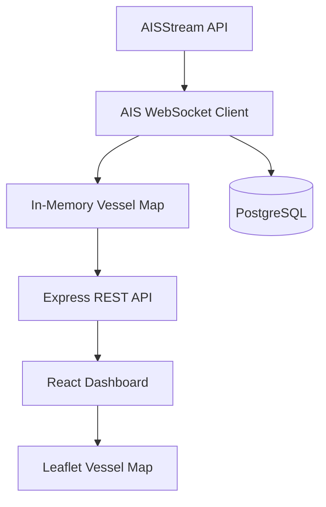
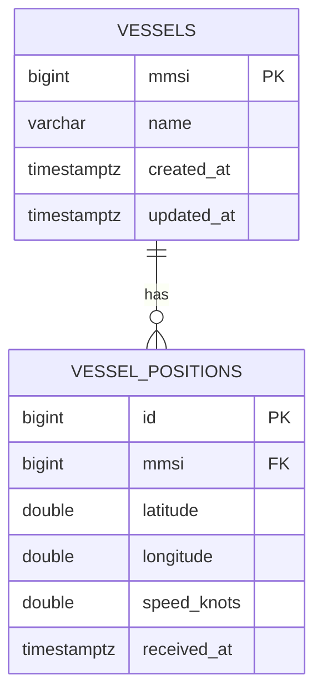
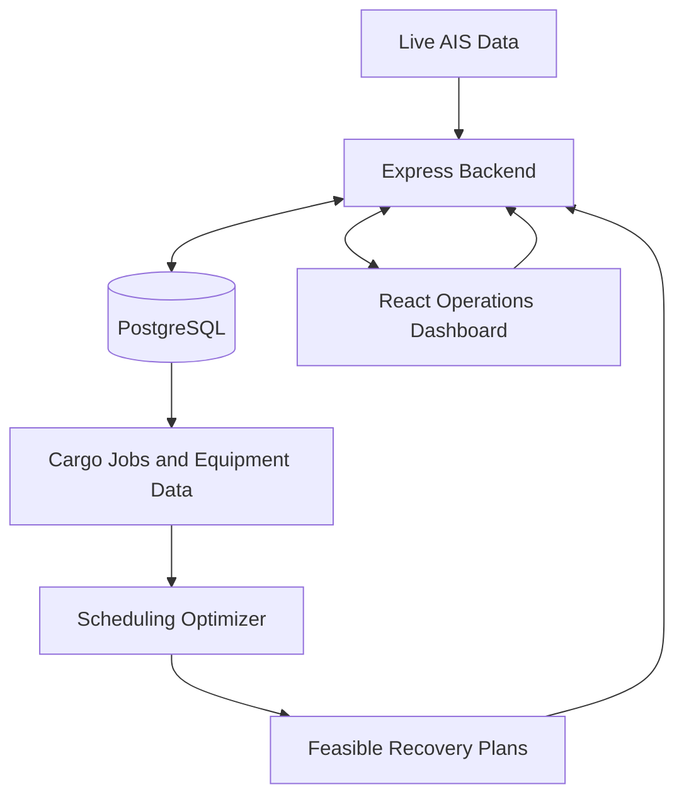

# PortPower AI — System Architecture

**Version:** 2.0 (Development Draft)  
**Updated:** November 8, 2026  
**Project:** Blue Economy Hackathon  
**Status:** Active Development

## 1. Project Overview

PortPower AI is a port operations decision-support platform that combines live vessel tracking, simulated port operations, and energy-aware scheduling optimization.

### Our objective

Help port managers anticipate vessel arrival disruptions, understand their operational consequences, and evaluate feasible recovery schedules while considering equipment availability, energy costs, and emissions.

The application does not autonomously control port equipment.

## 2. Technology Stack

| Layer | Technology | Responsibility |
|---|---|---|
| Frontend | React, TypeScript, Vite | Dashboard and user interaction |
| Map | React Leaflet, OpenStreetMap | Vessel visualization |
| Backend | Node.js, Express, TypeScript | APIs and vessel processing |
| Live data | AISStream WebSocket | Vessel position reports |
| Database | PostgreSQL | Persistent vessel and position data |
| Optimization | To be integrated | Scheduling and feasibility validation |

## 3. Current System Architecture



### Data flow

1. AISStream broadcasts vessel position reports.
2. The Node.js backend receives messages through a WebSocket.
3. The backend extracts and validates vessel information.
4. Valid vessel positions update an in-memory Map.
5. The backend asynchronously persists vessel information and position reports in PostgreSQL.
6. Express exposes the latest in-memory vessel positions through `/api/vessels`.
7. React fetches updated vessel information every five seconds.
8. Leaflet displays the vessel positions on an interactive map.

**Note:** The live API currently reads from memory rather than querying historical records from PostgreSQL.

## 4. Repository Structure

```text
PortPowerAI/
├── README.md
├── AGENTS.md
├── docs/
│   ├── TECHNICAL_SPEC.md
│   ├── API_AND_DATA_CONTRACTS.md
│   ├── TASK_BOARD.md
│   ├── ARCHITECTURE_V2.md
│   └── DEVELOPMENT_PROGRESS.md
├── apps/
│   └── web/
│       └── src/
│           ├── App.tsx
│           ├── components/
│           │   └── VesselMap.tsx
│           └── services/
│               └── vesselApi.ts
├── services/
│   └── vessel-api/
│       └── src/
│           ├── app.ts
│           ├── server.ts
│           ├── ais/
│           │   ├── aisClient.ts
│           │   └── vesselStore.ts
│           ├── config/
│           │   └── db.ts
│           ├── routes/
│           │   └── vesselRoutes.ts
│           └── repositories/
│               └── vesselRepository.ts
└── index.html
```

The existing standalone `index.html` energy demo remains separate from the new React application.

## 5. Current Database Schema

Database: `portpower_db`

### Table: vessels

| Column | Type | Description |
|---|---|---|
| mmsi | BIGINT PRIMARY KEY | Vessel identifier |
| name | VARCHAR(255) | Vessel name |
| created_at | TIMESTAMPTZ | First database insertion |
| updated_at | TIMESTAMPTZ | Latest identity update |

### Table: vessel_positions

| Column | Type | Description |
|---|---|---|
| id | BIGINT PRIMARY KEY | Position record identifier |
| mmsi | BIGINT FOREIGN KEY | References vessels |
| latitude | DOUBLE PRECISION | Latitude |
| longitude | DOUBLE PRECISION | Longitude |
| speed_knots | DOUBLE PRECISION | Reported speed |
| received_at | TIMESTAMPTZ | Backend receipt time |

### Entity relationship



## 6. Current API Endpoints

| Method | Endpoint | Description |
|---|---|---|
| GET | `/health` | Backend health check |
| GET | `/api/vessels` | Latest vessel positions in memory |

Future endpoints will support cargo operations, historical positions, equipment, and recovery simulations.

## 7. Current Functional Capabilities

- Live AISStream WebSocket subscription
- Validated vessel position extraction
- MMSI-based in-memory vessel tracking
- PostgreSQL vessel identity and position storage
- React vessel dashboard
- Interactive Leaflet map
- Search by vessel name and MMSI
- Vessel selection and details
- Five-second frontend polling

## 8. Planned Architecture



### Planned modules

**Vessel Intelligence:** Historical movement, position freshness, and arrival estimates.

**Port Operations:** Berths, cargo jobs, forklifts, battery status, and equipment assignments.

**Energy Management:** Charging capacity, power demand, fuel, costs, and emissions.

**Recovery Planning:** Detect disruptions and compare constraint-validated scheduling alternatives.

## 9. Data Integrity and Limitations

- AIS positions are real observations, but data coverage and freshness are not guaranteed.
- The current test subscription uses the Miami area, not the intended Gulf Coast reference port.
- The backend's current `lastUpdated` value represents receipt time, not guaranteed AIS transmission time.
- The vessel store is temporary and resets on backend restart.
- PostgreSQL persistence has been tested through SQL row counts, but restart persistence and long-term ingest reliability still require verification.
- The current system is not yet predicting docking times or producing operational recovery plans.
- Cargo and equipment data will initially be synthetic and clearly labeled.
- No API credentials should be committed to GitHub.

## 10. Development Ownership

**Lead Full-Stack Developer:** React, TypeScript, Express, AIS integration, database, and system integration.

**Optimization Developer:** Scheduling algorithms, operational constraints, feasibility checks, and recovery plan generation.

**Other Contributors:** Data assumptions, validation, testing, documentation, and presentation, according to team agreement.

## 11. Next Engineering Priorities

1. Verify persisted vessel records survive a backend restart.
2. Implement controlled AIS position sampling.
3. Add vessel freshness and filtering.
4. Introduce cargo jobs and equipment models.
5. Agree on optimizer request/response contracts.
6. Integrate the recovery engine.
7. Complete a disruption-recovery demonstration.

---

This document describes the current implementation and planned extensions. Planned capabilities must not be represented as already implemented.
